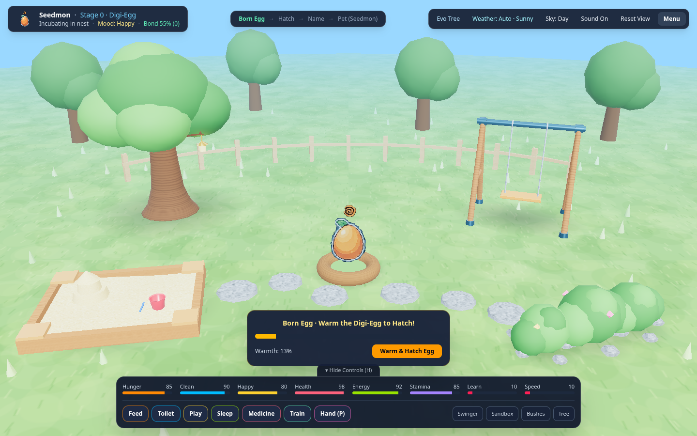
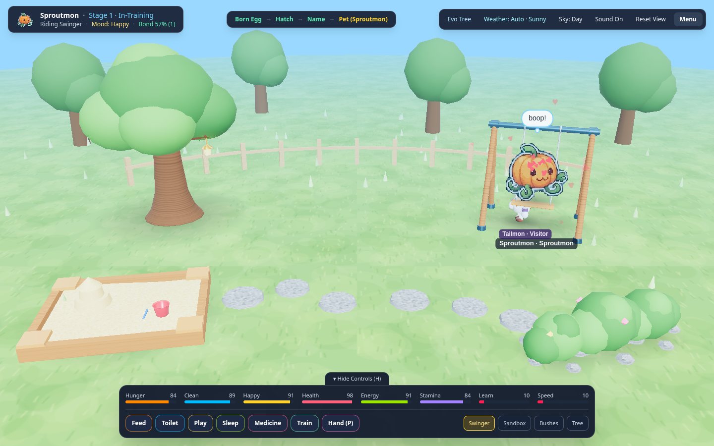
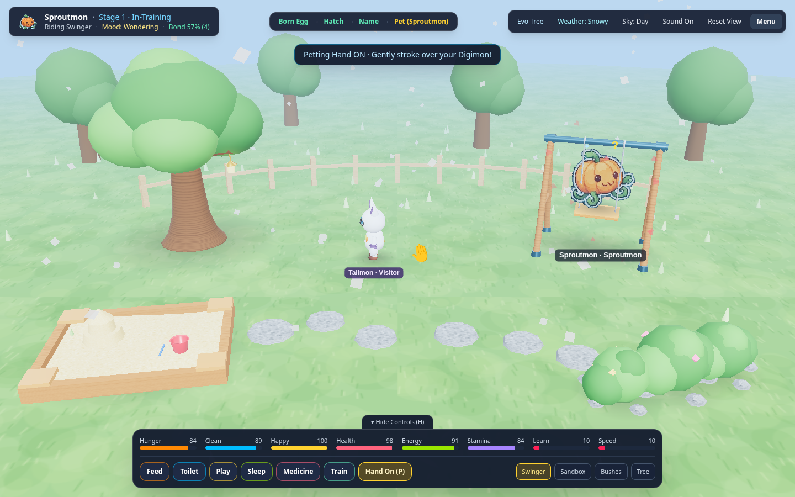
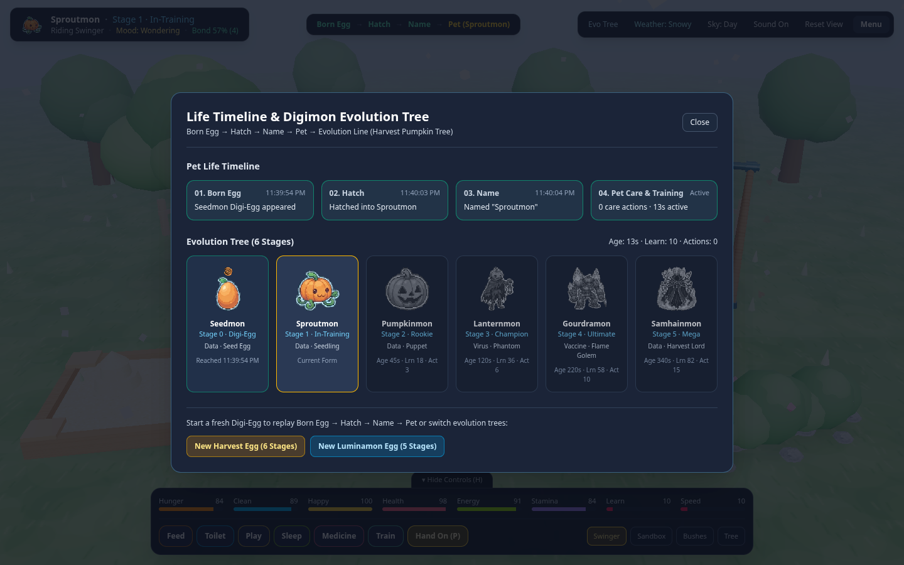
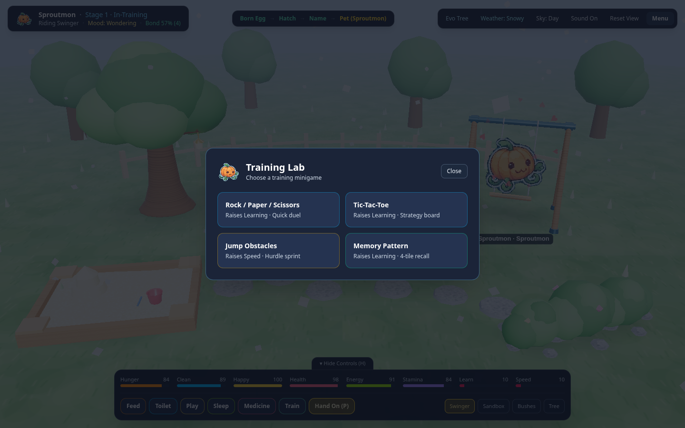

# DigiAI-Pet

**An interactive 3D + 2D AI virtual pet garden** built with React, TypeScript, Three.js, Tailwind CSS, and HTML5 2D Canvas FX—migrated from the original Python + Pygame desktop app (`Mohamadx2/DigiAI-Pet`) to a full-viewport WebGL experience.

Raise your Digimon from a **Born Egg** through **Hatch → Name → Pet** stages inside a living 3D garden featuring a climbable tree, swinger, sandbox, bushes, dynamic random weather (`Sunny`, `Rainy`, `Snowy`), an on-device **Tiny Petting Hand AI** with expressive 2D eye/mood FX, a random-visiting **3D Tailmon** character, and four **Training Lab** minigames.

---

## Screenshots

| **Born Egg & Nest Incubation** | **3D Playground & Visiting Tailmon** |
| :---: | :---: |
|  |  |

| **Snowy Weather & Petting Hand AI** | **Life Timeline & Digimon Evolution Tree** |
| :---: | :---: |
|  |  |

| **Training Lab Minigames** |
| :---: |
|  |

---

## Key Features

- **Full Lifecycle Timeline (`Born Egg → Hatch → Name → Pet`)**
  - Incubate your **Seedmon** Digi-Egg in the 3D nest by warming it or basking in sunny weather, watch it hatch, name your companion, and track timestamped milestones in the **Life Timeline & Evolution Tree** modal.
- **Two Multi-Stage Digimon Evolution Trees**
  - **Harvest Pumpkin Line (6 stages)**: `Seedmon` → `Sproutmon` → `Pumpkinmon` → `Lanternmon` → `Gourdramon` → `Samhainmon`
  - **Luminamon Line (5 stages)**: `Seedmon` → `Puwamon` → `Luminamon` → `Solarmon` → `Aethelmon`
  - Automatic border-flood sprite cleaner strips background checkerboards cleanly from sprite sheets.
- **3D Interactive Playground & Grounded 2D FX**
  - **Swinger**: Swing smoothly on a 3D animated swing set with floating heart bursts.
  - **Sandbox**: Dig in the sand beside bucket/shovel props with sand splash FX (splashes mud if raining).
  - **Garden Bushes**: Rustle 3D bushes and scatter leaves.
  - **Climbable Tree**: Climb and perch on the tree limb (also shelters your pet during rain).
- **Dynamic Random Weather System (`Sunny`, `Rainy`, `Snowy`)**
  - Cycles randomly between `Sunny`, `Rainy` (with `InstancedMesh` rain streaks and occasional thunder flashes), and `Snowy` (drifting 3D snowflakes and frosted ground tint), or lock weather manually from the top bar.
  - Weather directly affects egg warmth, energy drain, cleanliness in the sandbox, and autonomous playground choices.
- **Tiny On-Device AI & Interactive Petting Hand**
  - Online reinforcement model (`TinyPetBrain`) tracks **Bond % (trust)**, playfulness, sensitivity, and interaction history across sessions.
  - Toggle **Hand (`P`)** or rub directly over your pet: smooth gentle strokes calm and cheer your companion (`happy`, `wondering`), while rapid rough pokes or fast swipes startle or upset it (`scared`, `angry`).
  - Crisp 2D Canvas eye & expression FX for `happy`, `sad`, `angry`, `scared`, `tired`, `wondering`, `blink`, `sleep`, and `dizzy`.
- **Random-Visiting 3D Character (`Tailmon`)**
  - A multi-part textured 3D character built from `chr092a01_14409219.png` (striped tail, metallic Digicode Holy Ring, purple-cuffed clawed gloves, blue eyes) strolls in from the perimeter at random times, explores the meadow, waves hello to cheer up your pet, and walks back out.
- **4 Training Lab Minigames**
  - **Rock / Paper / Scissors** (Learning)
  - **Tic-Tac-Toe** (Learning)
  - **Memory Pattern** (Learning)
  - **Jump Obstacles** (Speed)
- **Day/Night Atmosphere, Audio & Persistence**
  - Auto/Day/Night lighting with glowing tree lantern at dusk/rain, procedural Web Audio sound cues, and automatic `localStorage` saving.

---

## Controls

| Action | Control |
| --- | --- |
| Orbit / Zoom Garden | Left-drag / Scroll wheel (`Reset View` in top bar) |
| Care Actions | Click **Feed**, **Toilet**, **Play**, **Sleep**, **Medicine**, **Train** in bottom dock |
| Petting Hand Mode | Click **Hand (`P`)** or press `P`, then stroke gently over your pet (rapid clicks poke!) |
| Playground Spots | Click the 3D **Swinger**, **Sandbox**, **Bushes**, **Tree**, or dock shortcuts |
| Weather & Sky | Click **Weather** (`Auto` / `Sunny` / `Rainy` / `Snowy`) or **Sky** (`Auto` / `Day` / `Night`) |
| Life Timeline & Evo Tree | Click **Evo Tree** or top timeline bar |
| Toggle Dock / Sound / Menu | Press `H` (dock), `M` (sound), `Esc` / `Q` (menu) |

---

## Development

```bash
npm install
npm run dev
```

Runs on `http://0.0.0.0:3000`.

```bash
npm run build
```
